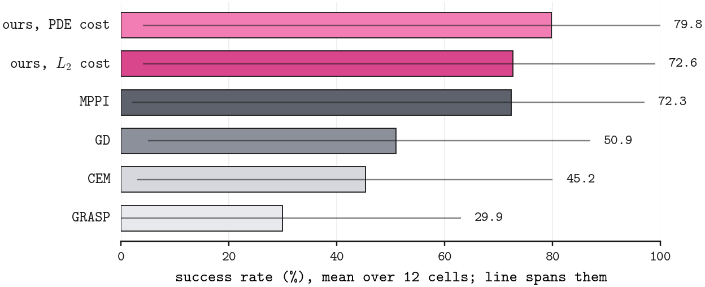
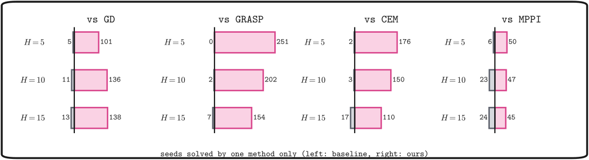
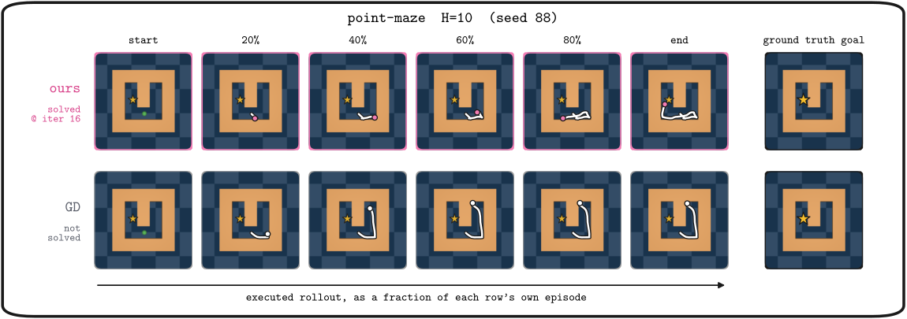
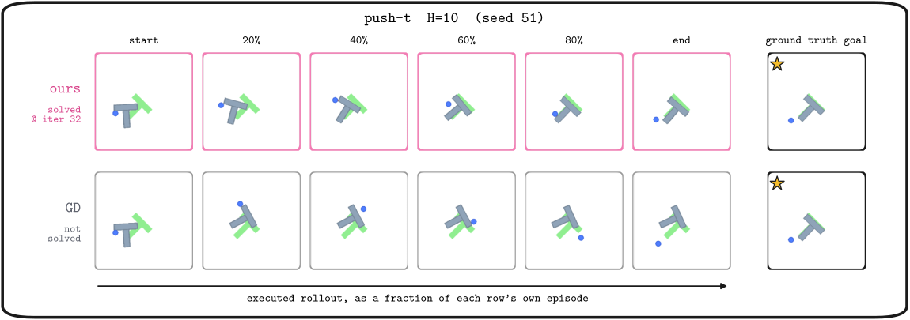

<div align="center">

<div id="user-content-toc">
  <ul align="center" style="list-style: none;">
    <summary>
      <h1>Latent Space Planning with Sequential Monte Carlo</h1>
      <p><a href="https://hrishikeshvish.github.io/">Hrishikesh Viswanath</a><sup>1</sup> &emsp; Anindita Ghosh<sup>2</sup> &emsp; Uttaran Bhattacharya<sup>3</sup> &emsp; <a href="https://ideas.cs.purdue.edu">Aniket Bera</a><sup>1</sup></p>
      <p><sup>1</sup>Department of Computer Science, Purdue University &emsp; <sup>2</sup>Saarland University &emsp; <sup>3</sup>Adobe Systems</p>
      <i>Preprint, 2026</i>
    </summary>
  </ul>
</div>

<a href="https://hrishikeshvish.github.io/smcplan/"></a> &emsp;
<a href="https://www.python.org/"></a> &emsp;
<a href="https://pytorch.org/"></a> &emsp;
<a href="https://developer.nvidia.com/cuda-toolkit"></a> &emsp;
<a href="LICENSE"></a>

<br><br>

<br>
<em>Each particle is a whole action sequence. Every iteration moves the population along the
cost-defined target, reweights it, resamples it when the effective sample size drops, and then
updates the plan from the weighted population.</em>
<br><br>

<div id="toc">
  <ul align="center" style="list-style: none;">
    <summary>
      <h2><a href="#overview">Overview</a> &emsp; <a href="#method">Method</a> &emsp; <a href="#results">Results</a> &emsp; <a href="#installation">Installation</a> &emsp; <a href="#data">Data</a> &emsp; <a href="#quick-start">Quick Start</a> &emsp; <a href="#reproducing-the-paper">Reproducing</a> &emsp; <a href="#baselines-and-third-party-code">Baselines</a> &emsp; <a href="#citation">Citation</a></h2>
    </summary>
  </ul>
</div>

</div>

---

## Overview

Planning in a learned world model usually means gradient descent on one action sequence. A single
trajectory is cheap, but it commits early, and the places where it gets stuck are exactly the
places where the world model is least trustworthy.

We plan with a **population of action sequences** instead. A plan is a mean sequence $\bm\mu$ with
a reference distribution $q(\cdot\mid\bm\mu)$ around it, and tilting that reference by the planning
cost $C$ gives a target

```math
\gamma_{\bm{\mu}}(\mathbf a) = q(\mathbf a \mid \bm{\mu}) \exp\!\big(-C(\mathbf a)/\alpha\big).
```

The plan moves by one optimizer step per iteration, so the targets of consecutive iterations form a
sequence, and sequential Monte Carlo is what carries a population across it. Each particle takes an
unadjusted Langevin step on the current target,

```math
\mathbf a_k^{(i)} = \mathbf a_{k-1}^{(i)} + \eta\, \nabla_{\mathbf a} \log \gamma_k\big(\mathbf a_{k-1}^{(i)}\big) + \sqrt{2\eta}\, \varepsilon_k^{(i)},
```

the population is reweighted by Jarzynski's equality,
$W_k^{(i)} = W_{k-1}^{(i)} G_k\big(\mathbf a_{k-1}^{(i)}, \mathbf a_k^{(i)}\big)$, and resampled when
its effective sample size falls. The plan is then updated along the weighted population gradient
$\mathbf g_k = \sum_i w_k^{(i)} \nabla_{\bm\mu} U_{\bm\mu_k}\big(\mathbf a_k^{(i)}\big)$, which is
the maximization step of the EM view of MPPI. The sampler and the optimizer are two halves of one
iteration: the E-step supplies the weights, the M-step moves the plan.

### Highlights

- **A population, not a trajectory.** Twelve particles explore in parallel, and resampling moves
  effort onto the ones that are working. The whole study runs at twelve candidates and 150
  iterations, which is also what every baseline gets.
- **Four propagation kernels, one planner.** ULA with Jarzynski weights, plus MALA, random-walk
  Metropolis and HMC, ported from [blackjax](https://github.com/blackjax-devs/blackjax) and checked
  against it in `planning/test_mcmc_kernels.py`.
- **A cost-to-go from a PDE on the latent roadmap.** Latent distance to the goal is a poor guide
  when the straight line in latent space crosses a wall. We build a roadmap over buffer latents,
  solve a heat or random-walk equation on it for a cost-to-go $V$, and add $\lambda_V V$ to the
  terminal distance. `planning/roadmap_cost.py`, `build_latent_buffer.py`.
- **Two world-model families.** DINO-WM (Point maze, Push-T, Wall) and LeWM/JEPA (Reacher, Cube),
  behind one planner interface.
- **Five planners in one codebase**, each at its authors' objective: GD, GRASP, CEM, MPPI and ours.
- **Every config behind a reported number ships as-is**, including the per-environment rollout
  chunking that keeps a 16 GB card from running out of memory at $H=15$.

---

## Method

One iteration is move, reweight, resample, update. `planning/em_smc.py` is the planner of the
paper's Algorithm 1; `planning/fk_planner.py` is an earlier Feynman-Kac variant in which the
cost-to-go enters only through the tempered weights, kept because the ablations compare against it.

The cost $C$ is a terminal latent distance plus, optionally, the roadmap cost-to-go. Setting
`planner.lambda_v=0` recovers the plain $L_2$ objective, which is the row the paper reports
alongside the PDE cost so the planner and the objective can be read apart.

<div align="center">

<br>
<em>The roadmap cost-to-go against plain latent distance.</em>
</div>

---

## Results

Success rate averaged over the twelve cells of the main table, four environments at horizons 5, 10
and 15, 100 seeds each. Every planner gets twelve candidate action sequences and 150 iterations
over the same pretrained world model, the same seeds and the same start and goal pairs.

<div align="center">

</div>

| Planner | Objective | Mean success (%) |
| :--- | :--- | :-: |
| **Ours** | PDE cost-to-go | **79.8** |
| **Ours** | $L_2$ | 72.6 |
| MPPI | as published | 72.3 |
| GD | as published | 50.9 |
| CEM | as published | 45.2 |
| GRASP | as published | 29.9 |

Per-cell numbers, confidence intervals and paired tests are in the paper.

<div align="center">

<br>
<em>Fraction of seeds solved at or before each iteration, every planner holding twelve particles.
Each environment is shown at the horizon where the margin over the strongest baseline is largest.</em>
<br><br>

<br>
<em>Paired per-seed comparison against each baseline. Both arms of a pair share the seed, hence the
start and the goal, so the difference is within-seed.</em>
<br><br>

<br>
<em>Success rate by propagation kernel, inside the same planner.</em>
</div>

<div align="center">
<table>
<tr>
<td align="center"><br><em>Point maze</em></td>
<td align="center"><br><em>Push-T</em></td>
<td align="center"><br><em>Cube</em></td>
</tr>
</table>
</div>

---

## Repository Structure

```
.
├── run.sh                        # one run at the paper's protocol (wraps plan.py)
├── plan.py                       # the planning entry point (Hydra)
├── train.py                      # DINO-WM world-model training (legacy path)
├── build_latent_buffer.py        # latent replay buffer -> roadmap cost-to-go
├── grasp_pseudocode.py           # minimal standalone GRASP reference
├── planning/
│   ├── em_smc.py                 # ours: SMC E-step + Adam M-step (Algorithm 1)
│   ├── fk_planner.py             # earlier Feynman-Kac variant
│   ├── mcmc_kernels.py           # ULA / MALA / RWM / HMC, verified against blackjax
│   ├── roadmap_cost.py           # the PDE cost-to-go on the latent roadmap
│   ├── em_target.py              # the tilted target and its incremental weight
│   ├── gd.py grasp.py cem.py mppi.py mpc.py   # baselines
│   ├── objectives.py             # terminal cost, roadmap term, action regularizer
│   └── evaluator.py              # episode rollout and scoring
├── models/                       # DINO-WM encoders/predictors + LeWM (JEPA) wrapper
├── env/                          # gym registrations and wrappers, plus vectorized envs
├── conf/
│   ├── plan.yaml plan_grasp.yaml # top-level entry configs
│   ├── env/*.yaml                # dataset paths and model dims
│   └── planner/*.yaml            # one config per planner per environment
├── scripts/
│   ├── common.sh                 # the three paths every script resolves from
│   ├── download_data.sh          # datasets and pretrained world models
│   ├── prepare_buffers.sh        # the five latent roadmap buffers
│   ├── sweep.sh                  # launch a sweep: table1, baselines, cube, ...
│   ├── reproduce.sh              # rebuild a table or figure from finished runs
│   └── baselines.sh              # check out the third-party submodules
├── writeup/                      # the sweep launchers and table generators themselves
├── figs/                         # the figure generators
├── third_party/                  # pinned submodules: baselines and upstream world models
└── assets/                       # the images in this README
```

---

## Installation

Tested on Ubuntu with Python 3.10, PyTorch 2.11 and CUDA 12.8.

**1. Environment**
```bash
git clone https://github.com/HrishikeshVish/smcplan.git
cd smcplan
./install.sh --conda --mujoco
conda activate grasp
```

`install.sh --help` lists the steps individually (`--conda`, `--mujoco`, `--dataset-dir`,
`--download-datasets`, `--extract-pusht-frames`). `--all` runs everything.

**2. Data, checkpoints and roadmap buffers**
```bash
bash scripts/download_data.sh /path/to/base   # datasets and pretrained world models
bash scripts/prepare_buffers.sh all           # the latent roadmaps the PDE cost is solved on
```
See [Data](#data) for what each step writes and how long it takes.

**3. Check the install**
```bash
python planning/test_mcmc_kernels.py
```

> [!IMPORTANT]
> `MUJOCO_GL` differs by environment. Reacher and Cube need `MUJOCO_GL=egl`. Point maze, Push-T and
> Wall need it **unset** with a display available (`export DISPLAY=:0`); setting it to `egl` there
> produces silently wrong renders. The sweep scripts in `writeup/` set this per environment.

---

## Data

Everything resolves from three paths, each an environment variable with a repo-relative default, so
no config holds an absolute path:

| Variable | Default | Holds |
| :--- | :--- | :--- |
| `DATASET_DIR` | `<repo>/data` | the datasets |
| `GRASP_CKPT_BASE` | `<repo>/checkpoints` | world models, loaded from `$GRASP_CKPT_BASE/outputs` |
| `GRASP_BUFFER_DIR` | `<repo>/latent_buffers` | the latent roadmap buffers |

`scripts/common.sh` sets them and every script sources it. `conf/plan*.yaml` and
`conf/planner/*.yaml` read the last two through `${oc.env:...}`, so exporting one is enough to move
a tree somewhere else.

| What | Get it | Prepare it |
| :--- | :--- | :--- |
| DINO-WM datasets and checkpoints (Point maze, Push-T, Wall) | `bash scripts/download_data.sh <base>` | — |
| LeWM data and checkpoints (Reacher, Cube) | same step | — |
| Latent roadmap buffers, five of them | — | `bash scripts/prepare_buffers.sh all` |

`download_data.sh` runs `install.sh`, which pulls the DINO-WM datasets and the pretrained world
models from the [OSF bucket](https://osf.io/bmw48/) published with DINO-WM into `<base>/datasets`
and `<base>/outputs`, then links them at `data/` and `checkpoints/` unless those already exist.

`prepare_buffers.sh` encodes dataset states with the frozen world model and stores the observed
transitions as `z_curr`/`z_next`; `planning/roadmap_cost.py` reads nothing else from a buffer. It
needs a GPU. The script prints the expected shape after each build, so a buffer that came out a
different size is visible at once:

| Environment | Buffer | Latent | Rows | `graph_n_nodes` |
| :--- | :--- | :-- | --: | --: |
| Point maze | `pointmaze_buffer.pt` | `proprio`, 10-D | 3,800 | 3,800 |
| Wall | `wall_buffer.pt` | `proprio`, 10-D | 12,600 | 12,600 |
| Push-T | `pusht_offline_replay_buffer.pt` | `proprio`, 10-D | 994,573 | 55,000 |
| Reacher | `lewm_reacher_fixed.pt` | `visual`, 192-D | 360,000 | 55,000 |
| Cube | `lewm_cube_buffer.pt` | `visual`, 192-D | 56,000 | 55,000 |

The row count is not cosmetic. Point maze and Wall set `graph_n_nodes` to the whole buffer, so a
buffer of a different size is a different roadmap. Point maze encodes only the episodes whose frames
are on disk, which is 200 of 2000 in the release, and the builder says so as it runs.

<details>
<summary><b>Where the shipped buffers came from</b></summary>

Point maze, Wall, Reacher and Cube were built by `build_latent_buffer.py`, with the flags
`prepare_buffers.sh` now records. The Push-T buffer was written by an earlier throwaway script and
additionally carries `y_curr`/`y_next`, the raw proprioceptive states; the roadmap never reads them,
so `build_latent_buffer.py --env pusht --latent-key proprio` produces an equivalent buffer.

</details>

---

## Quick Start

```bash
./run.sh pointmaze ours 10                        # our planner, Point maze, horizon 10
./run.sh pointmaze ours-l2 10                     # the same cell under the plain L2 cost
./run.sh pointmaze mppi 10                        # a baseline at the same budget
./run.sh pointmaze ours 10 5 planner.kernel=mala  # 5 trials, MALA propagation kernel
```

`./run.sh <env> <planner> <horizon> [n_evals]` sets the three things that are easy to get wrong by
hand and gives every planner the same twelve candidates and 150 iterations. `MUJOCO_GL` must be
`egl` for Reacher and Cube and **unset** for Point maze, Push-T and Wall, where `egl` renders
silently wrong frames. `goal_source` differs per environment. The rollout chunk caps peak memory,
since the DINO-WM rollout kept for autograd grows superlinearly with the horizon and runs a 16 GB
card out of memory at `H=15` without it. Anything after the trial count is passed to Hydra
untouched. The call it builds for the line above is

```bash
python plan.py model_name=point_maze planner=emsmc_pointmaze goal_H=10 \
  goal_source=random_state n_evals=1 save_images=False planner.num_particles=12 \
  planner.opt_steps=150 planner.eval_every=1 planner.lambda_v=auto planner.eval_chunk=4
```

Any config field can be overridden with Hydra's dotted syntax. Results go to
`plan_outputs/<timestamp>_<model_name>_gH<goal_H>/`, or to `$GRASP_RESULTS_DIR` if it is set, which
is how the sweeps collect one directory per seed.

| Environment | `model_name` | `planner` | `goal_source` | World model |
| :--- | :--- | :--- | :--- | :--- |
| Reacher | `lewm_reacher` | `emsmc_reacher` | `random_state` | LeWM |
| Point maze | `point_maze` | `emsmc_pointmaze` | `random_state` | DINO-WM |
| Wall | `wall_single` | `emsmc_wall` | `random_state` | DINO-WM |
| Push-T | `pusht` | `emsmc_pusht` | `dset` | DINO-WM |
| Cube | `lewm_cube` | `emsmc_cube` | `dset` | LeWM |

---

## Reproducing the Paper

Two phases. A sweep runs the planning, which is days of GPU time; rebuilding a table reads the
per-seed `result.txt` files a sweep wrote and takes seconds.

```bash
bash scripts/sweep.sh table1        # then, when it is done
bash scripts/reproduce.sh table1
```

Each cell of the main table is 100 seeds of one `plan.py` call. The launchers run them over the free
GPUs, claim each seed with a lock directory so several workers can share a sweep, and skip any seed
whose `result.txt` exists, so a sweep can be interrupted and resumed. `GPUS` picks the cards
(default `0 1`) and `ENVS` narrows `table1`.

| Result | Sweep | Rebuild |
| :--- | :--- | :--- |
| Tab. 1, the main planner comparison | `bash scripts/sweep.sh table1` and `bash scripts/sweep.sh baselines` | `bash scripts/reproduce.sh table1` |
| Tab. 4, Cube under LeFlow's protocol | `bash scripts/sweep.sh cube` | `bash scripts/reproduce.sh cube` |
| LeFlow and GC-IDM, the planners that train a network | `bash scripts/sweep.sh learned` | `bash scripts/reproduce.sh learned` |
| Tab. 6-8, M-step, budget, SMC and sensitivity | `bash scripts/sweep.sh ablations` | `bash scripts/reproduce.sh ablations` |
| Tab. 11, Wilson intervals and paired McNemar | covered by the sweeps above | `bash scripts/reproduce.sh ci` |
| Every figure the paper includes | covered by the sweeps above | `bash scripts/reproduce.sh figures` |
| The roadmap cost on the baselines | `bash scripts/sweep.sh pde-baselines` | included in `reproduce.sh figures` |
| Kernel comparison, JALA against MALA, RWM and HMC | `bash scripts/sweep.sh kernels` | included in `reproduce.sh figures` |

Tables are written as the `.tex` files the paper `\input`s; figures land in `figs/`. Running
`bash scripts/reproduce.sh all` rebuilds every one of them.

`writeup/equal_particle_stats.py` is the single source of per-seed outcomes that the tables read, so
a number can always be traced back to the seed directory it came from. The launchers the two
wrappers call are the originals in `writeup/`, which can still be run directly.

---

## Baselines and Third-Party Code

The baselines and the upstream world models are pinned submodules rather than vendored copies.
**None of them is needed to plan with this repository or to rebuild any table**: every baseline in
the paper is reimplemented in `planning/`, and the LeWM checkpoints are bundled.

```bash
bash scripts/baselines.sh             # check out all of them
bash scripts/baselines.sh LeFlow      # or one, by directory name
```

`third_party/README.md` lists what each one is for. `LeFlow` and `GCIDM` are pinned at the commits
the paper's runs used, and `scripts/sweep.sh learned` needs both checked out, since it trains them
on the offline data before planning with them. The other four are reference points.

---

## Planners

| `./run.sh` | `planner=` | Class | Objective |
| :--- | :--- | :--- | :--- |
| `ours`, `ours-l2` | `emsmc_<env>` | `planning/em_smc.py` | ours, Algorithm 1 |
| | `fk_<env>` | `planning/fk_planner.py` | earlier Feynman-Kac variant |
| `gd` | `gd`, `gd_cube` | `planning/gd.py` | gradient descent on the terminal latent distance (DINO-WM) |
| `grasp` | `grasp` | `planning/grasp.py` | lifted virtual states with dynamics-consistency penalties |
| `cem` | `cem` | `planning/cem.py` | cross-entropy method |
| `mppi` | `mppi` | `planning/mppi.py` | model-predictive path integral |
| | `mpc_cem` | `planning/mpc.py` | receding-horizon CEM |

Each baseline optimizes the objective its own authors report. The roadmap cost can be switched on
for `gd`, `cem` and `mppi` with `planner.lambda_v`, which is the study behind the appendix figure on
whether the cost transfers.

---

## Citation

```bibtex
@article{viswanath2026latentsmc,
  title   = {Latent Space Planning with Sequential Monte Carlo},
  author  = {Viswanath, Hrishikesh and Ghosh, Anindita and
             Bhattacharya, Uttaran and Bera, Aniket},
  journal = {arXiv preprint},
  year    = {2026}
}
```

## Acknowledgments

This codebase is a derivative of [DINO-WM](https://dino-wm.github.io/)
([paper](https://arxiv.org/abs/2411.04983)), and reuses its world-model training, datasets and
environment wrappers. The LeWM/JEPA path is built on
[stable-worldmodel](https://github.com/michael-psenka/le-wm-grasp). The GRASP baseline is
[Psenka et al.](https://www.michaelpsenka.io/grasp/). The MCMC kernels are ported from
[blackjax](https://github.com/blackjax-devs/blackjax) and verified against it. The Jarzynski-adjusted
Langevin scheme and the incremental weights follow Cuin et al. If you use this repository, please
also cite DINO-WM.

## License

MIT. See [LICENSE](LICENSE).
